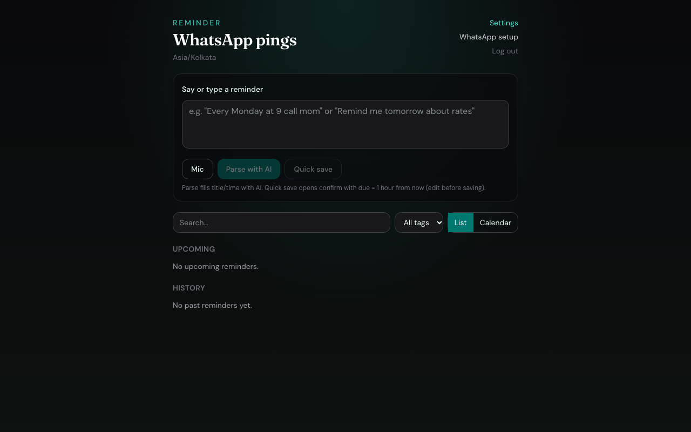
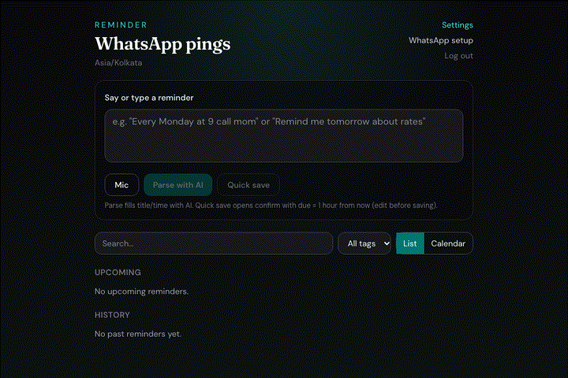
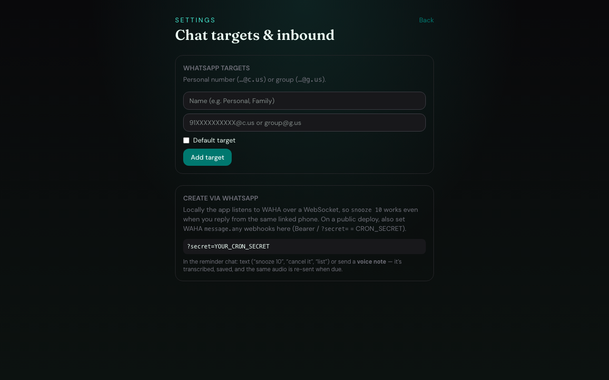
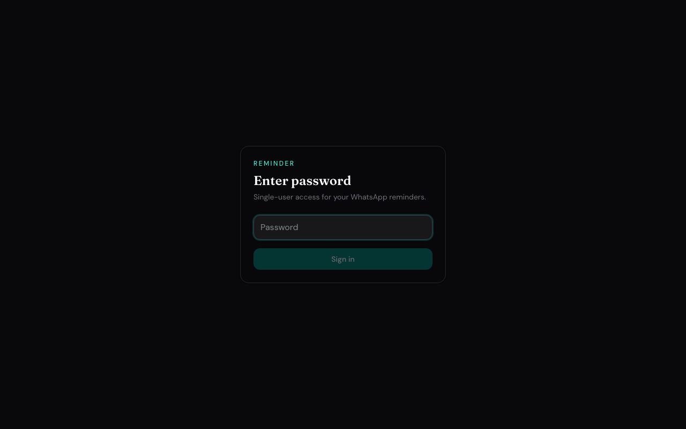
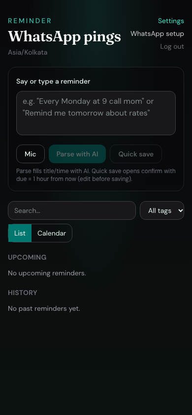

# Reminder App

**Natural-language reminders that ping you on WhatsApp.**

Type, speak, or WhatsApp a reminder. The app parses when it’s due, stores it in Postgres, and delivers through [WAHA](https://waha.devlike.pro/) at the right time — including voice notes.





## Overview

This is a **single-user** Next.js app for personal (or small household) reminders. It is not a multi-tenant SaaS product. You gate the UI with a password, point it at your database and WAHA instance, and optionally supply free LLM API keys for richer natural-language parsing.

## Features

- Password-gated web UI (list + calendar)
- Text input and microphone (Web Speech + Whisper fallback)
- Local deterministic parsing for common phrases; LLM failover when configured
- WhatsApp delivery via WAHA (`sendText` / `sendVoice`)
- Create, snooze, list, and cancel from WhatsApp
- Recurring daily / weekly reminders
- Tags and multiple chat targets (DM or group)
- Voice notes: transcribe, schedule, re-send audio at due time
- Local scheduler in `next dev` / `next start` + Vercel Cron support
- PWA shell assets; optional Capacitor config for a native wrapper

## Main workflows

1. **From the web UI** — sign in → type or dictate a reminder → confirm due time / repeat / target → save.
2. **From WhatsApp** — message your watched chat: `remind me at 5pm to call mom`, or send a voice note (+ optional time).
3. **At due time** — cron/scheduler claims pending rows and sends WhatsApp (text or stored voice).
4. **Snooze** — reply `snooze 10` / `snooze 1h` or use the UI.

## Technology stack

| Layer | Choice |
|-------|--------|
| Framework | Next.js 16 (App Router) |
| UI | React 19, Tailwind CSS 4 |
| Database | PostgreSQL + Prisma 6 |
| WhatsApp | WAHA HTTP API |
| NL / STT | OpenAI-compatible free LLMs (e.g. Groq) |
| Mobile shell | Capacitor (optional) |

## Architecture

See [docs/ARCHITECTURE.md](docs/ARCHITECTURE.md) for modules, data flow, and diagrams.

```text
src/
  app/           # Routes, API handlers, login, settings
  components/    # Reminder UI, WhatsApp setup
  lib/           # Auth, parse, WAHA, dispatch, inbound
prisma/          # Schema
docs/            # Architecture, security, screenshots
```

## Prerequisites

- Node.js 20+
- PostgreSQL
- A WAHA instance (for WhatsApp)
- Optional: LLM / Whisper API keys

## Quick start

```bash
git clone https://github.com/cryptic-exe/reminder-app.git
cd reminder-app
cp .env.example .env
cp llm-keys.example.json llm-keys.json
# Edit .env — never commit real secrets
npm install
npx prisma db push
npm run dev
```

Open [http://localhost:3000](http://localhost:3000) and sign in with `APP_PASSWORD`.

More detail: [docs/DEVELOPMENT.md](docs/DEVELOPMENT.md).

## Environment configuration

Copy `.env.example` → `.env`. Important variables:

| Variable | Purpose |
|----------|---------|
| `DATABASE_URL` | Postgres connection string |
| `APP_PASSWORD` | Login password |
| `SESSION_SECRET` | Cookie signing secret |
| `LLM_KEYS_FILE` / `LLM_KEYS_JSON` | Optional LLM keys |
| `USER_TIMEZONE` | e.g. `Asia/Kolkata` |
| `WAHA_BASE_URL` | WAHA HTTP base (include `http://` or `https://`) |
| `WAHA_API_KEY` | WAHA API key |
| `WHATSAPP_CHAT_ID` | Default `@c.us` / `@g.us` chat |
| `CRON_SECRET` | Bearer token for `/api/cron/dispatch` |

Full template: [`.env.example`](.env.example). Security notes: [docs/SECURITY.md](docs/SECURITY.md).

## Screenshots

| Desktop home | Settings |
|--------------|----------|
|  |  |

| Login | Mobile |
|-------|--------|
|  |  |

## API highlights

| Route | Role |
|-------|------|
| `POST /api/parse` | NL → structured reminder |
| `GET/POST /api/reminders` | List / create |
| `POST /api/reminders/[id]/snooze` | Snooze |
| `GET/POST /api/targets` | Chat targets |
| `POST /api/webhooks/waha` | Inbound WhatsApp |
| `GET /api/cron/dispatch` | Due sends (`Authorization: Bearer CRON_SECRET`) |

## Deployment

1. Provision Postgres (e.g. Neon) and set all env vars on the host (e.g. Vercel).
2. Deploy the Next.js app; `vercel.json` schedules `/api/cron/dispatch` every minute.
3. Point WAHA webhooks to `https://YOUR_HOST/api/webhooks/waha?secret=YOUR_CRON_SECRET`.
4. Open **WhatsApp setup** in the app to link the WAHA session (QR).

## Security and privacy

- Never commit `.env`, `llm-keys.json`, or `.data/` voice files.
- Rotate any key that may have leaked.
- This app stores reminder content you type or speak — treat the database as private.
- See [docs/SECURITY.md](docs/SECURITY.md).

## Troubleshooting

| Symptom | Check |
|---------|--------|
| Login fails | `APP_PASSWORD` in `.env` |
| No WhatsApp send | `WAHA_BASE_URL`, API key, session status, `WHATSAPP_CHAT_ID` |
| Voice ignored | WAHA media download enabled; watched chat id |
| Parse weak | Add keys to `llm-keys.json`; local parse still handles many phrases |
| Cron 401 | Bearer `CRON_SECRET` |

## Contributing

See [CONTRIBUTING.md](CONTRIBUTING.md).

## License

[MIT](LICENSE)

## Author

Published for learning and personal use. Configure your own WAHA and database — do not reuse example placeholders as production secrets.
