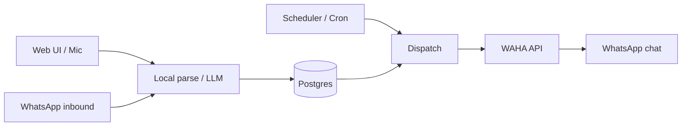

# Architecture

Reminder App is a single-user Next.js application that stores reminders in Postgres and delivers them through a self-hosted [WAHA](https://waha.devlike.pro/) WhatsApp gateway.

## High-level flow

## Major modules

| Area | Location | Role |
|------|----------|------|
| UI | `src/components/ReminderApp.tsx` | Create, list, calendar, snooze, tags |
| Auth | `src/lib/auth.ts`, `src/app/login` | Password cookie session |
| Parse | `src/lib/llm/*` | NL → structured reminder (local + LLM failover) |
| Inbound | `src/lib/inbound.ts`, `inbound-voice.ts` | WhatsApp text/voice commands |
| Dispatch | `src/lib/dispatch.ts`, `src/lib/waha.ts` | Send due reminders (text or voice) |
| Scheduler | `src/lib/scheduler.ts`, `src/instrumentation.ts` | Local poll of `/api/cron/dispatch` |
| Data | `prisma/schema.prisma` | Reminders, tags, chat targets |

## Data model (simplified)

- **Reminder** — title, due time, status, optional voice file path, recurrence, tags, chat target
- **ChatTarget** — WAHA chat id (`@c.us` or `@g.us`) for delivery routing
- **Tag** — labels for filtering

## External services

- **Postgres** — source of truth
- **WAHA** — WhatsApp session, sendText / sendVoice, events / polling
- **LLM providers** — optional; keys via `LLM_KEYS_FILE` / `LLM_KEYS_JSON` (Groq, etc.)
- **Whisper-compatible API** — voice transcription when available

## Auth model

Single shared `APP_PASSWORD`. Session is an HMAC-signed cookie (`SESSION_SECRET`). There is no multi-user RBAC.

## Design decisions

1. **WhatsApp-first delivery** — browser push was removed; delivery is WAHA.
2. **Local parse first** — common English phrases work without an LLM; LLM improves edge cases.
3. **Voice reminders** — audio is stored under `.data/voice/` and re-sent at due time.
4. **Clock times without a date** — interpreted on the user’s local calendar day (`USER_TIMEZONE`).
